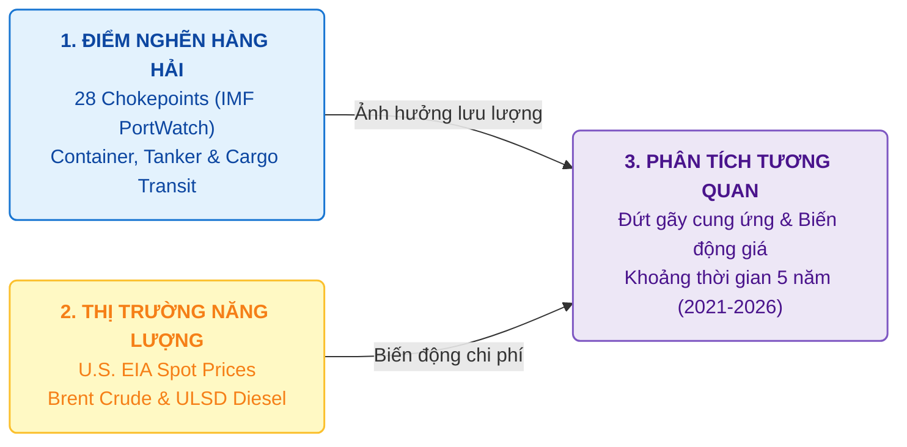
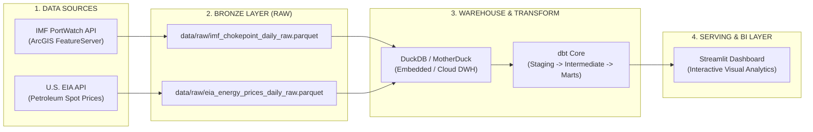

<div align="center">

# MARITIME SUPPLY CHAIN & ENERGY PRICE MONITOR
### Automated ELT Pipeline, Maritime Chokepoints & Fossil Fuel Analytics

**Dự án Portfolio Kỹ thuật Dữ liệu — Chuyên ngành Xử lý Dữ liệu**  
*Tác giả: **Lê Công Toàn***

<p align="center">
  <a href="https://www.python.org/" target="_blank">
    
  </a>
  <a href="https://duckdb.org/" target="_blank">
    
  </a>
  <a href="https://motherduck.com/" target="_blank">
    
  </a>
  <a href="https://www.getdbt.com/" target="_blank">
    
  </a>
  <a href="https://streamlit.io/" target="_blank">
    
  </a>
  <a href="https://arrow.apache.org/" target="_blank">
    
  </a>
</p>

</div>

---

## MỤC LỤC TỔNG QUAN

1. [Bối Cảnh Dự Án & Bản Chất Miền Nghiệp Vụ (Maritime Supply Chain Domain)](#1-bối-cảnh-dự-án--bản-chất-miền-nghiệp-vụ-maritime-supply-chain-domain)
2. [Kiến Trúc Đường Ống Dữ Liệu ELT (Data Architecture)](#2-kiến-trúc-đường-ống-dữ-liệu-elt-data-architecture)
3. [Mô Hình Dữ Liệu Kho (Data Warehouse & dbt Modeling)](#3-mô-hình-dữ-liệu-kho-data-warehouse--dbt-modeling)
4. [Giải Pháp Kỹ Thuật Dữ Liệu & Tự Động Hóa (Data Engineering & Automation)](#4-giải-pháp-kỹ-thuật-dữ-liệu--tự-động-hóa-data-engineering--automation)
5. [Hệ Thống Trực Quan Hóa Quản Trị (Streamlit Dashboard)](#5-hệ-thống-trực-quan-hóa-quản-trị-streamlit-dashboard)
6. [Hướng Dẫn Cài Đặt & Vận Hành (Quickstart)](#6-hướng-dẫn-cài-đặt--vận-hành-quickstart)
7. [Danh Mục Tài Liệu & Tuân Thủ Bản Quyền (Attribution & Compliance)](#7-danh-mục-tài-liệu--tuân-thủ-bản-quyền-attribution--compliance)

---

## 1. Bối Cảnh Dự Án & Bản Chất Miền Nghiệp Vụ (Maritime Supply Chain Domain)



### 1.1. Bối Cảnh & Mục Tiêu Dự Án
* **Quy mô dữ liệu:** Theo dõi toàn diện **28 điểm nghẽn hàng hải chiến lược toàn cầu** (IMF PortWatch) kết hợp với chuỗi giá năng lượng giao ngay (U.S. EIA Brent Crude & Diesel ULSD) trong giai đoạn **5 năm (2021–2026)** với gần **60.000+ bản ghi giao thông** và **2.900+ bản ghi giá năng lượng**.
* **Giá trị mang lại:** Xây dựng một nền tảng kỹ thuật dữ liệu hoàn chỉnh, minh họa năng lực thiết kế kho dữ liệu hiện đại, tự động hóa toàn bộ quá trình trích xuất, lưu trữ, biến đổi và trực quan hóa phân tích mối quan hệ giữa ách tắc vận tải biển và biến động giá nhiên liệu toàn cầu.

### 1.2. Các Thách Thức Kỹ Thuật Đã Giải Quyết
1. **Lệch pha chu kỳ giao dịch:** Dữ liệu tàu chạy liên tục 365 ngày/năm trong khi thị trường năng lượng chỉ giao dịch vào các ngày làm việc (~251 ngày/năm). Dự án ứng dụng thuật toán **Causal Forward-Fill** ở tầng Intermediate để xử lý đồng bộ thời gian mà không làm rò rỉ dữ liệu tương lai.
2. **Quản trị tầng dữ liệu thô (Bronze Layer):** Lưu trữ bất biến bằng định dạng nén `Parquet` với chiến lược ép kiểu chuỗi toàn bộ (`astype(str)`) ở tầng Ingestion để triệt để ngăn chặn lỗi gãy ống dẫn do thay đổi schema từ API nguồn.

---

## 2. Kiến Trúc Đường Ống Dữ Liệu ELT (Data Architecture)

Đường ống dữ liệu được thiết kế theo mô hình **Modern Data Stack / Lakehouse**, tối ưu hóa chi phí vận hành (Free-to-Host) và tốc độ truy vấn:



---

## 3. Mô Hình Dữ Liệu Kho (Data Warehouse & dbt Modeling)

Hệ thống biến đổi dữ liệu thông qua **dbt Core** theo cấu trúc 3 tầng chuẩn mực:

1. **Staging Layer (`stg_*`):** Đổi tên trường chuẩn hóa, ép kiểu (`TRY_CAST`), lọc bỏ các bản ghi trùng lặp và chuẩn hóa định dạng ngày tháng.
2. **Intermediate Layer (`int_*`):** Thực hiện logic nghiệp vụ phức tạp, xử lý đồng bộ lịch biểu thời gian, tạo bảng lịch liên tục (calendar spine) và áp dụng chiến lược **Causal Forward-Fill** cho giá năng lượng.
3. **Marts Layer (`fct_*` & `dim_*`):** Xây dựng các bảng Sự kiện (Fact Tables) và Chiều (Dimension Tables) theo mô hình chiều kim cương (Dimensional Modeling), phục vụ trực tiếp cho các truy vấn phân tích BI.

---

## 4. Giải Pháp Kỹ Thuật Dữ Liệu & Tự Động Hóa (Data Engineering & Automation)

* **Trích Xuất API Mạnh Mẽ:** Script Python tối ưu hóa cơ chế phân trang (`pagination offset`), bắt lỗi tự động với cấp số nhân thời gian chờ (`exponential backoff retry`).
* **Lưu Trữ Parquet Tối Ưu:** Dữ liệu thô được nén theo chuẩn `snappy`, giảm thiểu tối đa dung lượng lưu trữ nhưng vẫn đảm bảo tốc độ đọc ghi cực nhanh cho DuckDB.
* **Tự Động Hóa CI/CD:** Sẵn sàng tích hợp GitHub Actions để lên lịch chạy tự động định kỳ hàng tuần.

---

## 5. Hệ Thống Trực Quan Hóa Quản Trị (Streamlit Dashboard)

* **Giao Diện Trực Quan:** Xây dựng bằng `Streamlit` kết hợp `Plotly`, cung cấp cái nhìn tổng quan về xu hướng phương tiện qua các điểm nghẽn trọng yếu.
* **Biểu Đồ Tương Quan:** Trực quan hóa đường đi của lưu lượng tàu container/tanker song song với biến động giá dầu Brent và Diesel, hỗ trợ đánh giá tác động vĩ mô.

---

## 6. Hướng Dẫn Cài Đặt & Vận Hành (Quickstart)

### Bước 1: Clone Repository & Cấu Hình Môi Trường
```bash
git clone https://github.com/LeCongToan-work/maritime-energy-supplychain-monitor.git
cd maritime-energy-supplychain-monitor

# Tạo và kích hoạt môi trường ảo Python (3.10+)
python -m venv venv
# Trên Windows PowerShell:
.\venv\Scripts\Activate.ps1
# Trên macOS / Linux:
# source venv/bin/activate

# Cài đặt thư viện phụ thuộc
pip install --upgrade pip
pip install -r requirements.txt
```

### Bước 2: Cấu Hình Biến Môi Trường
Sao chép file mẫu `.env.example` thành `.env`:
```bash
cp .env.example .env
```
Mở file `.env` và điền API Key của bạn:
```env
EIA_API_KEY=your_actual_eia_api_key_here
MOTHERDUCK_TOKEN=your_optional_motherduck_token_here
```

### Bước 3: Chạy Ingestion Thu Thập Dữ Liệu Thô (Bronze Layer)
```bash
# Lấy dữ liệu 5 năm điểm nghẽn hàng hải IMF PortWatch
python -m src.ingest.ingest_imf_portwatch

# Lấy dữ liệu 5 năm giá năng lượng EIA
python -m src.ingest.ingest_eia_energy
```

### Bước 4: Thực Thi dbt Transformations (Silver & Gold Layers)
```bash
cd dbt_maritime
dbt run
```

### Bước 5: Khởi Chạy Streamlit Dashboard
```bash
streamlit run app.py
```

---

## 7. Danh Mục Tài Liệu & Tuân Thủ Bản Quyền (Attribution & Compliance)

* **IMF PortWatch Attribution:** Dữ liệu điểm nghẽn và lưu lượng tàu được cung cấp bởi sáng kiến **IMF PortWatch** của Quỹ Tiền Tệ Quốc Tế.
* **U.S. EIA Attribution:** Dữ liệu giá năng lượng giao ngay được trích xuất trực tiếp từ Open Data API của **Cơ quan Thông tin Năng lượng Hoa Kỳ (U.S. EIA)**.
* **Giấy Phép (License):** Dự án mở dưới giấy phép [MIT License](LICENSE).

---

<div align="center">
  <br>
  <i>Được xây dựng và phát triển bởi <b>Lê Công Toàn</b></i><br>
  <b>Kỹ sư Dữ liệu — Chuyên ngành Xử lý Dữ liệu</b>
</div>
