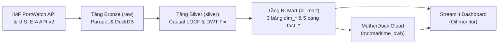

# Tài liệu Tổng quan Kiến trúc & Hướng dẫn Sử dụng Streamlit Dashboard (Oil Monitor)

**Ứng dụng:** [`app/streamlit_app.py`](file:///e:/maritime-energy-supplychain-monitor/app/streamlit_app.py)  
**Tiêu đề ứng dụng:** `"Oil monitor"`  
**Nhánh phát triển:** `feature/streamlit-dashboard`  
**Nguồn dữ liệu:** Kho dữ liệu `bi_mart` trên **MotherDuck Cloud (`md:maritime_dwh`)**, tự động fallback về **DuckDB Local** ([`data/maritime_dwh.duckdb`](file:///e:/maritime-energy-supplychain-monitor/data/maritime_dwh.duckdb)) hoặc **Parquet Gold** (`data/gold/*.parquet`), tích hợp từ **IMF PortWatch** (28 điểm nghẽn hàng hải) và **U.S. EIA API v2** (giá dầu thô Brent & dầu diesel ULSD), giai đoạn `01/01/2021 – 01/11/2026` (`59.668` bản ghi ngày–điểm nghẽn).

---

## 1. Kiến trúc Hệ thống & Cấu trúc Thư mục (Architectural & Directory Overview)

Hệ thống tuân thủ mô hình **Medallion Architecture (`raw` $\rightarrow$ `silver` $\rightarrow$ `bi_mart`)** kết hợp **Star Schema** (`dim_*` & `fact_*`) phục vụ trực tiếp cho ứng dụng BI trên Streamlit:

| Thư mục / Module | File Trọng tâm | Vai trò Kiến trúc |
| :--- | :--- | :--- |
| **`src/ingest/`** | [`ingest_imf_chokepoints.py`](file:///e:/maritime-energy-supplychain-monitor/src/ingest/ingest_imf_chokepoints.py), [`ingest_eia_energy.py`](file:///e:/maritime-energy-supplychain-monitor/src/ingest/ingest_eia_energy.py) | Thu thập dữ liệu thô hàng ngày từ ArcGIS FeatureServer (IMF PortWatch) và U.S. EIA API v2 vào tầng Bronze (`raw`). |
| **`src/process/`** | [`process_data.py`](file:///e:/maritime-energy-supplychain-monitor/src/process/process_data.py), [`build_gold_marts.py`](file:///e:/maritime-energy-supplychain-monitor/src/process/build_gold_marts.py) | Chuẩn hóa `area_name`, đồng bộ lịch 365 ngày bằng *Causal Forward-Fill (LOCF)* từ mốc neo `2020-12-31`, chuẩn hóa sai số làm tròn DWT ở tầng `silver` và xây dựng các bảng chiều/sự kiện/thay thế tuyến ở tầng `bi_mart`. |
| **`src/utils/`** | [`outlier_consensus_checker.py`](file:///e:/maritime-energy-supplychain-monitor/src/utils/outlier_consensus_checker.py), [`validate_pipeline_outputs.py`](file:///e:/maritime-energy-supplychain-monitor/src/utils/validate_pipeline_outputs.py) | Kiểm định bất thường đồng thuận kép ($\text{Modified Z-Score MAD} > 3.5 \land \text{Tukey IQR Fence}$), gán nhãn tự động `L00`–`L10` (`AO`, `IO`, `TC`, `LS`, `DATA_ANOMALY`) và kiểm tra toàn vẹn dữ liệu đầu ra. |
| **`src/load/`** | [`load_to_motherduck.py`](file:///e:/maritime-energy-supplychain-monitor/src/load/load_to_motherduck.py) | Đồng bộ 14 bảng và 30 ràng buộc `PRIMARY KEY` / `FOREIGN KEY` lên MotherDuck Cloud (`md:maritime_dwh`). |
| **`dbt_maritime/`** | [`geopolitical_events.csv`](file:///e:/maritime-energy-supplychain-monitor/dbt_maritime/seeds/geopolitical_events.csv), [`chokepoint_rerouting_map.csv`](file:///e:/maritime-energy-supplychain-monitor/dbt_maritime/seeds/chokepoint_rerouting_map.csv), [`chokepoint_coordinates.csv`](file:///e:/maritime-energy-supplychain-monitor/dbt_maritime/seeds/chokepoint_coordinates.csv) | Các bảng danh mục tĩnh (Seeds) và mô hình SQL dbt cho 3 tầng dữ liệu. |
| **`app/`** | [`streamlit_app.py`](file:///e:/maritime-energy-supplychain-monitor/app/streamlit_app.py) | Ứng dụng Dashboard tương tác 2 trang ("Oil monitor") phục vụ Ban điều hành và Chuyên viên Phân tích Rủi ro Chuỗi cung ứng. |



---

## 2. Luồng Dữ liệu & Nghiệp vụ Phân tích trên Dashboard (Core Workflow & Data Flow)

Khi khởi động, [`load_bi_mart_data()`](file:///e:/maritime-energy-supplychain-monitor/app/streamlit_app.py#L244-L300) truy vấn đầy đủ **8 bảng thuộc schema `bi_mart`** theo thứ tự ưu tiên 3 lớp (`MotherDuck Cloud` $\rightarrow$ `DuckDB Local` $\rightarrow$ `Parquet Gold Local`):

1. **`bi_mart.dim_chokepoints` (`28` dòng):** Tọa độ địa lý, phân vùng hàng hải, phân loại vai trò kinh tế (`chokepoint_role`: *Origin Energy Export Hub*, *Global Transit Corridor*, *Rerouting Alternative*, *Regional Maritime Passage*), tỷ trọng tàu dầu (`avg_tanker_share_pct`) và mức nền chuẩn `2021–2022`.
2. **`bi_mart.dim_geopolitical_events` (`4` dòng `EVT_01`–`EVT_04`):** Sự cố Ever Given (`03/2021`), Hạn hán Panama (`07/2023`), Khủng hoảng Biển Đỏ (`11/2023`), Phong tỏa Hormuz (`02/2026`).
3. **`bi_mart.dim_chokepoint_rerouting_map` (`8` dòng):** Ánh xạ điểm nghẽn chính sang tuyến đường biển thay thế (ví dụ: `Bab el-Mandeb` / `Suez Canal` $\leftrightarrow$ `Cape of Good Hope`, `Panama Canal` $\leftrightarrow$ `Magellan Strait`, `Strait of Hormuz` $\rightarrow$ *Không có tuyến biển thay thế*).
4. **`bi_mart.fact_energy_prices_daily` (`2.131` dòng):** Giá `Brent ($/bbl)`, `ULSD ($/gal & $/bbl)`, `Crack Spread (ULSD × 42 − Brent)`, biến đổi dừng $I(0)$ (`diff_1d`, `diff_7d`, `log_ret_1d`), độ biến động 30 ngày (`brent_volatility_30d`) và cờ ngày nghỉ điền khuyết (`brent_is_ffill`, `ulsd_is_ffill`).
5. **`bi_mart.fact_chokepoint_transit_daily` (`59.668` dòng):** Lưu lượng và trọng tải tàu theo ngày, trung bình trượt `MA7`, sai phân dừng $I(0)$ (`diff_1d`, `diff_7d`), `zscore_90d` và mức cảnh báo (`daily_alert_severity`).
6. **`bi_mart.fact_chokepoint_energy_regime_daily` (`59.668` dòng):** Tích hợp tương quan trượt 90 ngày trên cả chuỗi mức độ và **chuỗi sai phân dừng 7 ngày $I(0)$** (`rolling_corr_90d_diff7d_brent`, `rolling_corr_90d_diff7d_ulsd`, `rolling_corr_90d_total_diff7d_brent`, `rolling_corr_90d_total_diff7d_ulsd`).
7. **`bi_mart.fact_red_sea_cape_rerouting_daily` (`2.131` dòng):** Chỉ số đổi tuyến hàng ngày giữa Biển Đỏ và Mũi Hảo Vọng (`cape_rerouting_share_total_pct`, `cape_rerouting_share_tanker_pct`, `cape_rerouting_share_container_pct`).
8. **`bi_mart.fact_outlier_consensus_labeled_daily` (`59.668` dòng):** Kết quả kiểm định đồng thuận kép ($\text{MAD ModZ} > 3.5 \land \text{Tukey IQR Fence}$) tách bạch 3 nhóm: Cú sốc ngắn hạn $I(0)$ (`is_shock_consensus_outlier`: `AO`/`IO`/`TC`), Dịch chuyển chế độ dài hạn (`is_struct_consensus_outlier`: `LS`), và Lỗi tín hiệu cảm biến AIS (`L10: DATA_ANOMALY`).

---

## 3. Chi tiết Chức năng Từng Trang & Tiêu chuẩn Thiết kế (Key Code Patterns & Standards)

### 3.1. Thanh điều hướng & Bộ lọc hợp nhất bên trái (`Sidebar`)
- Cấu hình trang: `page_title="Oil monitor"`, icon 🚢, layout `wide`. Mặc định thu gọn sidebar (`initial_sidebar_state="collapsed"`).
- **CSS Tối ưu Giao diện:** Thiết lập padding top cho `.block-container` ở mức `2.8rem !important` và đưa `header[data-testid="stHeader"]` về trong suốt (`transparent`), giải quyết hoàn toàn lỗi vạch đen che khuất thanh thông báo phía trên.
- **2 Chế độ Chọn Thời Gian Linh Hoạt:**
  1. **Theo Năm & Tháng:** Dropdown chọn năm (`2021`–`2026` hoặc "Tất cả các năm") và chọn tháng (`Tháng 01`–`Tháng 12` hoặc "Cả năm"), giúp lọc nhanh dữ liệu mà không cần thao tác nhiều lần.
  2. **Khoảng ngày tùy chọn (Lịch):** `st.date_input` cho phép kéo thả chính xác khoảng ngày từ `01/01/2021` đến `01/11/2026`.
- **📍 Chọn điểm nghẽn theo dõi:** `st.multiselect` trong 28 điểm nghẽn; toàn bộ biểu đồ và thẻ KPI tự động thích ứng.
- **🚢 Loại tàu phân tích *(Trang 2)*:** `Tổng số tàu` | `Tàu dầu (Tanker)` | `Tàu hàng rời & container`.

### 3.2. Trang 1 · Tổng quan Điều hành (`Executive Overview`)
1. **Banner Kết luận Tự sinh & Kiểm soát Độ tươi Dữ liệu:**
   - Tự động tổng hợp số điểm nghẽn ở mức cảnh báo `High`/`Critical` trên tổng số `28` điểm nghẽn, Top 3 điểm nghẽn giảm sâu nhất, mức lệch lưu lượng so với nền chuẩn, lưu lượng tàu vòng qua Mũi Hảo Vọng, cùng giá **Brent** và **Crack Spread**.
   - Nhãn độ tươi dữ liệu tự đổi màu: `● Tươi (≤ 3 ngày)`, `● Trễ nhẹ (4–7 ngày)`, `● Quá hạn (> 7 ngày)`.
2. **Hệ thống 4 Thẻ KPI Cấp Điều Hành:**
   - Giữ nguyên cấu trúc chuẩn hóa: Điểm nghẽn giảm sâu nhất (tên điểm, `% vs nền`, TB kỳ vs nền `... tàu/ngày`), Trung bình nhóm chọn, Giá dầu Brent & Crack Spread, và Lưu lượng hấp thụ tại Mũi Hảo Vọng (`... tàu/ngày` và tỷ lệ hấp thụ `%`). Đã chuẩn hóa toàn bộ đơn vị hiển thị thành chữ `ngày` đầy đủ thay vì viết tắt.
3. **Biểu đồ Chính 2 Tầng Phân Tầng Thời Gian:**
   - **Tầng 1:** Đường `% lệch MA7 so với nền 2021–2022` của các điểm nghẽn được chọn.
   - **Tầng 2:** Đồng biến động giá dầu **Brent (`$/bbl`)**, **Diesel ULSD proxy (`$/bbl`)**, và **Biên lọc dầu Crack Spread (`$/bbl`)**. Các sự kiện địa chính trị được gắn cờ với nhãn tiếng Việt rõ ràng, tự động phân bố cao độ trục `yshift` tránh trùng lặp đè chữ.

### 3.3. Trang 2 · Phân tích Điểm nghẽn (`Operational & Econometric Analytics`)
1. **4 Thẻ KPI Phân Tích Chuyên Sâu Tương Ứng Với 4 Biểu Đồ Bên Dưới:**
   - **Thẻ 1 (Biến động trung bình so với nền):** Tóm lược tỷ lệ chênh lệch trung bình của nhóm điểm nghẽn, đi kèm mức lệch lớn nhất và điểm nghẽn có lưu lượng cao nhất trong kỳ.
   - **Thẻ 2 (Lưu lượng thực tế trung bình ngày):** Phản ánh tổng số tàu/ngày thực tế qua các điểm nghẽn đã chọn và so sánh trực tiếp với mức nền chuẩn `2021–2022`.
   - **Thẻ 3 (Tỷ trọng lưu lượng các điểm nghẽn):** Thống kê phân bổ tỷ trọng phần trăm của các điểm nghẽn được chọn trong tổng lưu lượng quan sát.
   - **Thẻ 4 (Tương quan trượt 90 ngày với giá dầu):** Đánh giá mức độ đồng biến động giữa thay đổi lưu lượng tàu và giá dầu Brent (hệ số từ `-1.0` đến `+1.0`), phát hiện ngay cú sốc nguồn cung khi tương quan chuyển âm sâu.
2. **Biểu đồ Cột Biến Động Lưu Lượng Theo Tuần (Kèm Nút Bật/Tắt Bản Đồ Nhiệt):**
   - Mặc định hiển thị dưới dạng **Biểu đồ cột nhóm (`go.Bar`, `barmode="group"`)**, phân định rõ cột dương (xanh ngọc) và cột âm (đỏ cam) theo từng tuần.
   - Tích hợp nút checkbox cho phép chuyển đổi sang dạng Bản đồ nhiệt (Heatmap) khi cần quan sát bức tranh tổng thể đa điểm dài hạn.
3. **Diễn Biến Lưu Lượng Thực Tế Dạng Cột vs Dải Nền Chuẩn:**
   - Vẽ lưu lượng thực tế hàng ngày dưới dạng cột (`go.Bar`), phủ lên đường xu hướng `MA7` và dải nền $\pm 1\text{ SD}$ `2021–2022`.
   - Gắn nhãn các điểm bất thường đồng thuận kép (`L01`–`L10`): Dịch chuyển cấu trúc dài hạn (`LS`), Cú sốc ngắn hạn chuỗi dừng (`AO/IO/TC`), và Lỗi tín hiệu AIS (`L10: DATA_ANOMALY`).
4. **Bản đồ Phân Bố Lưu Lượng & Hành Lang Tuyến Biển Thay Thế (`Scattergeo`):**
   - Thể hiện vị trí 28 điểm nghẽn toàn cầu với kích thước điểm tỷ lệ với lưu lượng và màu sắc cảnh báo theo `% lệch nền`.
   - Nối tuyến đường biển thay thế tương ứng (`Bab el-Mandeb` $\leftrightarrow$ `Cape of Good Hope`, `Panama` $\leftrightarrow$ `Magellan`) bằng đường nét chấm màu xanh ngọc, kèm chỉ số tổng lưu lượng 2 tuyến để xác minh hiện tượng đổi luồng hàng hải.
5. **Đồng Biến Động Chuẩn Hóa & Hệ Số Tương Quan Trượt 90 Ngày Trên Chuỗi Dừng $I(0)$:**
   - **Tầng trên:** "Tốc độ tăng/giảm so với ngày đầu kỳ (Chuẩn hóa về 100)" của Lưu lượng tàu và Giá dầu Brent/Diesel.
   - **Tầng dưới:** "Mức độ biến động cùng chiều / ngược chiều giữa tàu và giá dầu (Trong 90 ngày)" từ `-1.0` đến `+1.0`, chứng minh sự chuyển đổi trạng thái (Regime shift) khi có khủng hoảng nguồn cung.
   - Đã loại bỏ các chú thích học thuật phức tạp ("Cách đọc biểu đồ"), thay bằng các định nghĩa trực quan, dễ hiểu cho người dùng.

---

## 4. Cài đặt, Cấu hình & Kiểm thử (Setup & Verification Commands)

### 4.1. Biến môi trường (`.env` hoặc Streamlit Secrets)
- `MOTHERDUCK_TOKEN`: Token kết nối MotherDuck Cloud (`md:maritime_dwh`). Nếu không cấu hình, ứng dụng tự động đọc từ `data/maritime_dwh.duckdb` hoặc `data/gold/*.parquet`.
- `EIA_API_KEY`: Khóa API U.S. EIA v2 (dùng khi chạy pipeline cập nhật dữ liệu `src/ingest/ingest_eia_energy.py`).

### 4.2. Các lệnh khởi chạy & kiểm thử chuẩn (Preflight & Smoke Tests)
```powershell
# 1. Kiểm tra cú pháp ứng dụng Streamlit
venv\Scripts\python.exe -m py_compile app/streamlit_app.py

# 2. Kiểm tra chất lượng dữ liệu & ràng buộc PK/FK trong kho dữ liệu
venv\Scripts\python.exe -m src.utils.validate_pipeline_outputs

# 3. Khởi chạy Streamlit Dashboard cục bộ
venv\Scripts\streamlit.exe run app/streamlit_app.py
```

