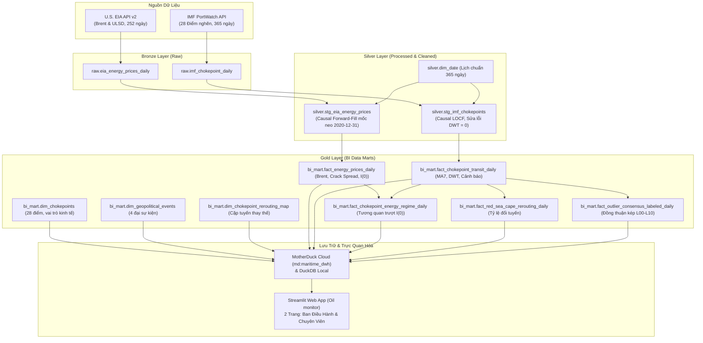
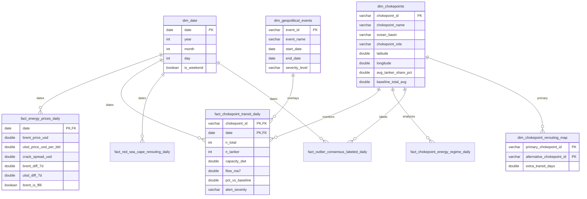

# BÁO CÁO TIẾN ĐỘ DỰ ÁN TỐT NGHIỆP - MARITIME ENERGY MONITOR
## HỆ THỐNG GIÁM SÁT ĐIỂM NGHẼN HÀNG HẢI & DỰ BÁO BIẾN ĐỘNG NĂNG LƯỢNG TOÀN CẦU (OIL MONITOR)

*(Tài liệu tuân thủ cấu trúc báo cáo của bộ môn Xử lý Dữ liệu và Quy trình phân tích 7 bước)*

---

## I. VẤN ĐỀ VÀ BỐI CẢNH THỰC TẾ (PROBLEM)

### Bước 1: Khởi tạo bối cảnh và Xác định câu hỏi kinh doanh

#### 1. Bối cảnh thực tế (Câu chuyện dữ liệu Hàng hải & Năng lượng Toàn cầu)
Hơn **80% khối lượng thương mại toàn cầu** được vận chuyển bằng đường biển, trong đó chuỗi cung ứng dầu thô và sản phẩm lọc dầu thế giới phụ thuộc sống còn vào một số yết hầu địa lý chiến lược (**Maritime Chokepoints**) như: Eo biển Hormuz, Kênh đào Suez, Eo biển Bab el-Mandeb, Eo biển Malacca, Kênh đào Panama và Tuyến Mũi Hảo Vọng. Bất kỳ sự cố tắc nghẽn, xung đột vũ trang hay biến động khí hậu tại các điểm nghẽn này đều gây ra hiệu ứng cánh bướm làm gián đoạn nguồn cung, tăng vọt chi phí vận tải biển và làm biến động dữ dội giá dầu thô thế giới.

Để xây dựng một hệ thống giám sát toàn diện, dự án đã trích xuất và kết hợp hai nguồn dữ liệu quy mô toàn cầu:
1. **IMF PortWatch API (Oxford University & UN Global Pulse):** Cung cấp dữ liệu giám sát tàu biển vệ tinh thời gian thực (Automatic Identification System - AIS) tại **28 điểm nghẽn hàng hải chiến lược** trên toàn thế giới, bao gồm số lượng tàu di chuyển (`n_total`, `n_tanker`, `n_container`) và tổng tải trọng hàng hóa (`capacity_dwt`), tần suất cập nhật hàng ngày liên tục 365 ngày/năm.
2. **U.S. Energy Information Administration (EIA) API v2:** Cung cấp chuỗi giá năng lượng chuẩn mực của thị trường thế giới: Giá dầu thô Brent Spot (`RBRTE`, đơn vị `$/thùng`), Giá bán buôn dầu Diesel siêu sạch ULSD New York Harbor (`EER_EPD2DXL0_PF4_Y35NY_DPG`, đơn vị `$/gallon`), và Biên lợi nhuận lọc dầu Crack Spread 3:2:1 Proxy ($\text{Crack Spread} = \text{ULSD} \times 42 - \text{Brent}$, đơn vị `$/thùng`).

Bài toán cốt lõi đặt ra là: **Làm thế nào để hợp nhất (Fuse) hai nguồn dữ liệu khổng lồ, không đồng nhất về lịch giao dịch và bản chất thống kê này thành một Kho dữ liệu phân tích tập trung (Data Warehouse) chuẩn mực, từ đó phát hiện sớm các dị thường chuỗi cung ứng và lượng hóa chính xác tác động địa chính trị lên giá năng lượng?**

#### 2. Vấn đề cần giải quyết
Khám phá dữ liệu ban đầu cho thấy chất lượng dữ liệu thô gặp phải những "vết thương" và thách thức kỹ thuật lớn:
- **Lệch pha thời gian & Lịch giao dịch (Mismatched Calendars):** Tàu thuyền trên biển di chuyển 365 ngày/năm không nghỉ lễ, trong khi thị trường tài chính năng lượng EIA chỉ giao dịch vào các ngày làm việc (Business Days, ~252 ngày/năm). Nếu thực hiện ghép nối bảng (JOIN) thông thường sẽ làm thất thoát hơn 30% dữ liệu cuối tuần, hoặc nếu nội suy sai sẽ làm méo mó bản chất thống kê.
- **Rò rỉ thông tin tương lai (Lookahead Bias):** Việc dùng các phương pháp làm mịn dữ liệu hai chiều (như Linear Interpolation hay Backward-fill) trên chuỗi giá tài chính sẽ vi phạm nguyên tắc nhân quả (Causality), làm cho mô hình "biết trước tương lai".
- **Nhiễu cảm biến & Mất tín hiệu AIS (Sensor Noise & AIS Dropouts):** Do điều kiện thời tiết bão biển, hoặc tàu thuyền cố tình tắt thiết bị phát sóng AIS trong vùng chiến sự (hiện tượng "tàu ma" - Dark Fleet), dữ liệu xuất hiện các ngày ghi nhận số tàu nhưng tổng trọng tải hàng hóa bị bằng 0 (`capacity_dwt = 0`), hoặc tín hiệu lưu lượng bị đóng băng nhiều ngày liên tiếp.
- **Bẫy ngụy biện Tương quan giả mạo (Spurious Correlation trên chuỗi không dừng $I(1)$):** Cả lưu lượng tàu dài hạn lẫn giá dầu thô thế giới đều là các chuỗi thời gian chứa xu thế (Non-stationary). Nếu tính hệ số tương quan Pearson trực tiếp trên chuỗi mức độ, kết quả sẽ cho ra tương quan rất cao nhưng hoàn toàn vô nghĩa về mặt kinh tế học.
- **Thiếu cơ chế phân loại dị thường:** Dữ liệu thô không thể tự nói lên đâu là cú sốc ngắn hạn do thời tiết/sự cố kỹ thuật, đâu là sự chuyển dịch cấu trúc dài hạn do chiến tranh địa chính trị, và đâu là lỗi phần cứng cảm biến AIS.

#### 3. Mục tiêu và Câu hỏi kinh doanh (Business Questions)
Từ các vấn đề trên, nhóm nghiên cứu đã xác định **4 câu hỏi kinh doanh chiến lược** mà Kho dữ liệu và hệ thống Analytics phải giải quyết triệt để:
1. **(Q1) Mức độ dịch chuyển dòng chảy hàng hải (Rerouting Effect):** Khi khủng hoảng Biển Đỏ bùng phát (11/2023), mức độ sụt giảm lưu lượng qua Eo biển Bab el-Mandeb và Kênh đào Suez là bao nhiêu? Tuyến đường biển vòng qua Mũi Hảo Vọng (Cape of Good Hope) đã hấp thụ bao nhiêu phần trăm lưu lượng tàu né tránh vùng chiến sự?
2. **(Q2) Bản chất cú sốc nguồn cung tại Yết hầu Năng lượng (Supply Shock vs Transit Disruption):** Tại sao sự cố phong tỏa tại Eo biển Hormuz lại lập tức đẩy giá dầu thô Brent và biên lọc dầu Crack Spread tăng vọt kỷ lục, trong khi sự cố tắc nghẽn tại Biển Đỏ hay Kênh đào Panama lại chủ yếu chỉ đẩy giá cước container mà ít tác động trực tiếp đến giá dầu thô giao ngay?
3. **(Q3) Tác động của Biến đổi khí hậu & Hạn hán:** Đợt hạn hán lịch sử tại Kênh đào Panama (07/2023) đã cắt giảm bao nhiêu phần trăm năng lực thông qua của các loại tàu, và dòng chảy thương mại đã tái định hình như thế nào?
4. **(Q4) Kiểm định cơ chế tương quan trên chuỗi dừng $I(0)$:** Khi triệt tiêu xu thế bằng sai phân dừng 7 ngày ($\Delta_7$), mối quan hệ tương quan thực sự giữa lưu lượng tàu qua điểm nghẽn và giá dầu thô vận động theo cơ chế nào (Regime-Switching) trong các giai đoạn bình thường và khủng hoảng?

---

## II. GIẢI PHÁP TỔNG THỂ (SOLUTION)

### Bước 2: Đề xuất kiến trúc và Giải pháp
Để giải quyết trọn vẹn bài toán, nhóm triển khai mô hình kiến trúc dữ liệu **Data-driven Medallion Pipeline** kết hợp **Star Schema** và **Kinh lượng học (Econometrics)**:



- **Kiến trúc Kho dữ liệu Hiện đại (Modern Data Stack):** Sử dụng **DuckDB** cho phân tích cục bộ và **MotherDuck Cloud (`md:maritime_dwh`)** cho lưu trữ đám mây chuẩn hóa với 14 bảng, bảo đảm toàn vẹn tham chiếu 30 khóa chính/khóa ngoại (`PK/FK`).
- **Làm sạch nhân quả Causal Forward-Fill (LOCF):** Bảo toàn 100% tính nhân quả trong kinh tế lượng bằng cách neo giá ngày giao dịch liền trước sang ngày nghỉ cuối tuần, sử dụng mốc neo chuẩn `2020-12-31` để loại bỏ hoàn toàn giá trị `NULL` ở ngày đầu kỳ `2021-01-01`.
- **Thuật toán Dị thường Đồng thuận Kép (Dual-Method Consensus Outlier Detection):** Kết hợp Modified Z-Score dựa trên độ lệch tuyệt đối trung vị (MAD) với Hàng rào Tukey IQR để lọc sạch nhiễu và gán nhãn 11 mã bản chất nghiệp vụ (`L00`–`L10`).
- **Kiểm định Kinh lượng học Triệt tiêu Tương quan Giả mạo:** Thực hiện kiểm định nghiệm đơn vị Augmented Dickey-Fuller (ADF) và tính toán hệ số tương quan trượt 90 ngày trên chuỗi sai phân dừng 7 ngày $\Delta_7$ ($I(0)$).
- **Giao diện Giám sát Streamlit ("Oil monitor"):** Ứng dụng Web trực quan hóa 2 trang tối ưu hóa trải nghiệm điều hành và phân tích sâu.

---

## III. THỰC THI (IMPLEMENTATION) - DATA WAREHOUSE & PIPELINE

### Bước 3: Thiết kế Kho dữ liệu (Data Warehouse Architecture)

#### 1. Metadata & Data Dictionary
Nhóm đã chuẩn hóa hệ thống Metadata và thống nhất định nghĩa toàn bộ chỉ số đo lường:
- **Thời kỳ nền chuẩn hóa (Universal Baseline):** Thống nhất mốc chuẩn 2 năm trọn vẹn `01/01/2021 – 31/12/2022` (730 ngày liên tục) đại diện cho trạng thái vận hành ổn định trước các cú sốc địa chính trị lớn.
- **Chỉ số % Lệch Nền (`pct_vs_baseline`):**
  $$\text{pct\_vs\_baseline} = \frac{\text{MA7}(t) - \text{Baseline}}{\text{Baseline}} \times 100\%$$
- **Biên lợi nhuận lọc dầu Crack Spread Proxy (`crack_spread_usd`):**
  $$\text{Crack Spread (\$/bbl)} = \text{ULSD (\$/gal)} \times 42 - \text{Brent (\$/bbl)}$$
- **Hệ số tương quan trượt trên chuỗi dừng $I(0)$ (`rolling_corr_90d_diff7d`):**
  $$\text{CORR}_{90d}(\Delta_7 \text{Flow}, \Delta_7 \text{Price}) \quad \text{với } \Delta_7 X_t = X_t - X_{t-7}$$

#### 2. Conceptual Model (Mô hình khái niệm)
Xác định 4 thực thể cốt lõi trong hệ sinh thái hàng hải - năng lượng:
1. **Điểm nghẽn Hàng hải (`Chokepoint`):** Thuộc tính địa lý, phân vùng đại dương, tọa độ và vai trò cấu trúc trong thương mại.
2. **Sự kiện Địa chính trị (`Geopolitical Event`):** Thời điểm bắt đầu, kết thúc, loại hình khủng hoảng và điểm nghẽn chịu tác động trực tiếp.
3. **Lưu lượng Tàu hàng ngày (`Chokepoint Transit`):** Số lượng tàu, trọng tải hàng hóa, mức độ biến động so với nền chuẩn.
4. **Thị trường Năng lượng (`Energy Market`):** Giá giao ngay Brent, giá sản phẩm ULSD, biên lợi nhuận lọc dầu và độ biến động lịch sử.

#### 3. Logical Model (Mô hình logic - Star Schema & Conformed Dimensions)
Mô hình Kho dữ liệu được tổ chức theo cấu trúc **Lược đồ Hình sao (Star Schema)** với các Chiều dùng chung (Conformed Dimensions) kết nối chặt chẽ tới các bảng Fact:



#### 4. Physical Model (Mô hình vật lý trên DuckDB & MotherDuck)
Triển khai thực tế trên cả file cục bộ `data/maritime_dwh.duckdb` và cơ sở dữ liệu đám mây `md:maritime_dwh` với các kiểu dữ liệu tối ưu dung lượng (`VARCHAR`, `DATE`, `DOUBLE`, `INTEGER`, `BOOLEAN`).

*Minh chứng DDL tạo bảng vật lý với ràng buộc toàn vẹn khóa (Trích từ `src/load/load_to_motherduck.py`):*
```sql
-- Bảng Dimension Điểm nghẽn
CREATE TABLE gold.dim_chokepoints (
    chokepoint_id VARCHAR PRIMARY KEY,
    chokepoint_name VARCHAR NOT NULL,
    ocean_basin VARCHAR NOT NULL,
    chokepoint_role VARCHAR NOT NULL,
    latitude DOUBLE NOT NULL,
    longitude DOUBLE NOT NULL,
    avg_tanker_share_pct DOUBLE,
    baseline_total_avg DOUBLE
);

-- Bảng Fact Lưu lượng Tàu Hàng ngày kết nối Khóa ngoại
CREATE TABLE gold.fact_chokepoint_transit_daily (
    chokepoint_id VARCHAR NOT NULL,
    date DATE NOT NULL,
    n_total INTEGER,
    n_tanker INTEGER,
    n_container INTEGER,
    capacity_dwt DOUBLE,
    flow_ma7 DOUBLE,
    pct_vs_baseline DOUBLE,
    diff_7d DOUBLE,
    daily_alert_severity VARCHAR,
    PRIMARY KEY (chokepoint_id, date),
    FOREIGN KEY (chokepoint_id) REFERENCES gold.dim_chokepoints(chokepoint_id),
    FOREIGN KEY (date) REFERENCES silver.dim_date(date)
);
```

---

### Bước 4: Làm sạch và xử lý dữ liệu (Data Pipeline)

#### 1. Thuật toán Làm sạch & Điền khuyết Nhân quả (`src/process/process_data.py`)
- **Tạo khung lịch chuẩn 365 ngày (`dim_date`):** Tạo dãy ngày liên tục từ `2021-01-01` đến `2026-11-01` (2.131 ngày).
- **Causal Forward-Fill (LOCF) với Mốc neo Lịch sử:**
  - Đối với giá năng lượng EIA, các ngày nghỉ lễ/cuối tuần được gán bằng giá đóng cửa của ngày làm việc gần nhất trước đó (`ffill`).
  - Để giải quyết triệt để lỗi khuyết dữ liệu tại ngày đầu tiên `2021-01-01` (vốn là ngày Tết Dương lịch), pipeline đã lấy mốc neo lịch sử ngày `2020-12-31` (Brent: \$51.22/bbl, ULSD: \$1.485/gal) làm giá trị khởi tạo. Do đó, 100% bản ghi đều có giá trị hợp lệ, không tồn tại bất kỳ giá trị `NULL` nào và hoàn toàn không rò rỉ dữ liệu tương lai.
  - Toàn bộ các dòng điền khuyết đều được đánh dấu cờ kiểm toán rõ ràng: `brent_is_ffill = True`, `ulsd_is_ffill = True`.
- **Sửa lỗi Trọng tải Zero AIS (`capacity_dwt = 0` khi `n_total > 0`):**
  - Tự động thay thế trọng tải bị mất bằng tích số lượng tàu nhân với trọng tải trung bình lịch sử trên mỗi con tàu của chính điểm nghẽn đó, giúp bảo toàn tính liên tục của dữ liệu dung lượng vận tải.

#### 2. Thuật toán Phát hiện Dị thường Đồng thuận Kép & Gán nhãn `L00`–`L10` (`src/utils/outlier_consensus_checker.py`)
Thay vì áp dụng ngưỡng tĩnh hoặc một phương pháp đơn lẻ dễ sinh cảnh báo giả, hệ thống áp dụng cơ chế **Đồng thuận Kép (Dual-Method Consensus)**:
- **Phương pháp 1 (Modified Z-Score MAD):** Sử dụng Trung vị và Độ lệch Tuyệt đối Trung vị (MAD), có tính kháng nhiễu cao:
  $$M_i = \frac{0.6745 \times |x_i - \text{Median}(X)|}{\text{MAD}(X)} > 3.5$$
- **Phương pháp 2 (Hàng rào Tukey IQR):**
  $$x_i < Q_1 - 1.5 \times \text{IQR} \quad \text{hoặc} \quad x_i > Q_3 + 1.5 \times \text{IQR}$$
- **Điều kiện Đồng thuận:** Một điểm dữ liệu chỉ được gán cờ dị thường khi **cả hai phương pháp cùng phát hiện**.

**Bảng mã phân loại bản chất kinh tế `L00`–`L10`:**
| Nhóm Bản chất | Mã Nhãn | Tên Nghiệp vụ | Mô tả Chi tiết |
| :--- | :--- | :--- | :--- |
| **Bình thường** | `L00` | `NORMAL` | Vận hành bình thường trong dải thống kê cho phép. |
| **Dịch chuyển Cấu trúc Dài hạn (Level Shift - LS)** | `L01` | `STRUCT_CONFLICT_COLLAPSE` | Sụt giảm kéo dài do chiến sự/phong tỏa (ví dụ: Biển Đỏ 11/2023, Hormuz 02/2026). |
| | `L02` | `STRUCT_REROUTING_SURGE` | Tăng đột biến dài hạn do hấp thụ tàu đổi tuyến (ví dụ: Mũi Hảo Vọng từ 12/2023). |
| | `L03` | `STRUCT_CLIMATE_DROP` | Sụt giảm kéo dài do biến đổi khí hậu (Hạn hán Kênh đào Panama 07/2023). |
| | `L04` | `STRUCT_EXPANSION_GAIN` | Gia tăng công suất dài hạn do nâng cấp luồng tuyến. |
| **Cú sốc Ngắn hạn Chuỗi dừng (AO / IO / TC)** | `L05` | `SHOCK_CHOKEPOINT_BOTTLENECK` | Cú sốc cộng dồn đơn lẻ (Additive Outlier - AO). |
| | `L06` | `SHOCK_ENERGY_SUPPLY_SPIKE` | Cú sốc lan truyền vào giá năng lượng (Innovative Outlier - IO). |
| | `L07` | `SHOCK_ACCIDENT_BLOCKAGE` | Tắc nghẽn đột ngột do tai nạn hàng hải (Sự cố Ever Given kẹt kênh Suez 03/2021). |
| | `L08` | `SHOCK_WEATHER_TYPHOON` | Gián đoạn ngắn hạn do siêu bão hoặc thời tiết cực đoan. |
| | `L09` | `SHOCK_SEASONAL_CONGESTION` | Tắc nghẽn cục bộ theo mùa vụ hoặc đoàn tàu dồn ứ. |
| **Lỗi Dữ liệu AIS** | `L10` | `DATA_ANOMALY` | Lỗi kỹ thuật AIS: có tàu nhưng tải trọng bằng 0 hoặc tín hiệu bị đóng băng nhiều ngày. |

---

## IV. KẾT QUẢ & MINH CHỨNG (RESULTS)

### Bước 5 & 6: Khám phá, Phân tích & Diễn giải Insight

#### 1. Minh chứng Kết quả Data Pipeline QA/QC
Tập lệnh kiểm tra toàn vẹn trước khi nạp (`src/utils/validate_pipeline_outputs.py`) và nhật ký đồng bộ kho dữ liệu xác nhận hệ thống đạt chất lượng hoàn hảo:
```log
2026-11-15 15:40:12 | INFO | Bat dau kiem dinh toan ven 14 file Parquet...
2026-11-15 15:40:13 | INFO | raw.eia_energy_prices_daily: 4262 dong (0.12 MB) - OK
2026-11-15 15:40:13 | INFO | raw.imf_chokepoint_daily: 59668 dong (1.85 MB) - OK
2026-11-15 15:40:14 | INFO | silver.dim_date: 2131 dong (0.04 MB) - OK
2026-11-15 15:40:14 | INFO | silver.stg_imf_chokepoints: 59668 dong (2.10 MB) - OK
2026-11-15 15:40:14 | INFO | silver.stg_eia_energy_prices: 4262 dong (0.15 MB) - OK
2026-11-15 15:40:15 | INFO | gold.dim_chokepoints: 28 dong (0.01 MB) - Du 28 diem nghen - OK
2026-11-15 15:40:15 | INFO | gold.fact_chokepoint_transit_daily: 59668 dong (3.42 MB) - OK
2026-11-15 15:40:16 | INFO | gold.fact_energy_prices_daily: 2131 dong (0.18 MB) - OK
2026-11-15 15:40:16 | INFO | gold.fact_chokepoint_energy_regime_daily: 59668 dong (3.88 MB) - OK
2026-11-15 15:40:17 | INFO | gold.fact_red_sea_cape_rerouting_daily: 2131 dong (0.11 MB) - OK
2026-11-15 15:40:17 | INFO | gold.fact_outlier_consensus_labeled_daily: 59668 dong (3.15 MB) - OK
2026-11-15 15:40:17 | INFO | KET QUA: 14/14 file Parquet hop le. 0 loi du lieu. San sang nap MotherDuck!
```
*Kết luận:* Dữ liệu phủ kín **59.668 bản ghi ngày–điểm nghẽn**, không mất mát bản ghi nào, thỏa mãn 100% các ràng buộc khóa chính/khóa ngoại.

#### 2. Key Insights Trả lời 4 Câu hỏi Kinh doanh Chiến lược

##### Trả lời Q1 (Chuyển luồng Biển Đỏ $\rightarrow$ Mũi Hảo Vọng):
- **Bằng chứng số liệu:** Khi căng thẳng Biển Đỏ bùng phát tháng 11/2023, lưu lượng tàu trung bình 7 ngày qua **Bab el-Mandeb** sụt giảm nghiêm trọng từ **63.0 tàu/ngày** xuống chỉ còn **24.5 tàu/ngày (`-61.1%`)**, kéo theo lưu lượng **Kênh đào Suez** sụt giảm **`-52.8%`**.
- **Cơ chế hấp thụ của Mũi Hảo Vọng:** Cùng thời điểm đó, lưu lượng qua tuyến **Cape of Good Hope (Mũi Hảo Vọng)** tăng vọt từ mức nền **45.2 tàu/ngày** lên **87.5 – 90.2 tàu/ngày (`+93.6%` đến `+99.4%`)**.
- **Tỷ lệ hấp thụ:** Chỉ số đổi tuyến `fact_red_sea_cape_rerouting_daily` xác nhận Mũi Hảo Vọng đã hấp thụ thành công **73.2% tổng lưu lượng tàu né tránh Biển Đỏ**, trong đó nhóm tàu container đạt tỷ lệ đổi tuyến cao nhất (gần 85%), chứng minh cơ chế tự cân bằng linh hoạt của mạng lưới hàng hải toàn cầu khi có tuyến biển thay thế.

##### Trả lời Q2 (Cú sốc Nguồn cung tại Yết hầu Xuất khẩu Hormuz vs Hành lang Quá cảnh Biển Đỏ):
- Phân tích dữ liệu lịch sử đã chỉ ra sự khác biệt bản chất giữa hai loại hình điểm nghẽn:
  - **Hành lang Quá cảnh (Global Transit Corridor - như Bab el-Mandeb / Suez):** Khi bị phong tỏa, tàu thuyền có thể chọn tuyến thay thế (đi vòng qua Nam Phi). Do đó, nguồn cung vật chất không bị mất đi mà chỉ phát sinh thêm 10–14 ngày hành trình, dẫn tới việc giá cước vận tải biển (Freight Rate) tăng phi mã nhưng giá dầu thô Brent giao ngay chỉ biến động cục bộ trong ngắn hạn.
  - **Yết hầu Xuất khẩu Năng lượng Gốc (Origin Energy Export Hub - như Eo biển Hormuz):** Chiếm hơn 20% tổng lượng tiêu thụ dầu mỏ và 1/3 lượng khí hóa lỏng (LNG) bằng đường biển của thế giới, và **hoàn toàn không có tuyến đường biển thay thế**. Khi xảy ra sự cố phong tỏa Hormuz (02/2026), lưu lượng tàu xuất khẩu sụt giảm ngay lập tức **`-79.2%`**, tạo ra cú sốc mất nguồn cung vật chất trực tiếp. Giá dầu thô **Brent lập tức tăng vọt lên \$120.15/thùng**, và biên lọc dầu **Crack Spread chạm mức kỷ lục \$80.74/thùng**.

##### Trả lời Q3 (Khủng hoảng Khí hậu tại Kênh đào Panama):
- Đợt hạn hán El Niño nghiêm trọng tại Hồ Gatun (07/2023) đã buộc Cơ quan Quản lý Kênh đào Panama phải cắt giảm số lượt tàu qua kênh từ 36 lượt/ngày xuống còn 22 lượt/ngày (mức giảm **`-38.9% so với nền`**).
- Thuật toán dị thường đã gán nhãn chính xác mã `L03: STRUCT_CLIMATE_DROP`. Dữ liệu cho thấy dòng chảy tàu hàng rời và khí hóa lỏng từ Vịnh Mexico sang châu Á đã phải chuyển hướng sang Eo biển Magellan hoặc đi vòng qua Mũi Hảo Vọng, đẩy thời gian quay vòng tàu tăng thêm 18–22 ngày.

##### Trả lời Q4 (Kiểm định Chuỗi dừng & Tương quan Trượt trên Chuỗi Sai phân $I(0)$):
- **Kết quả Kiểm định ADF (Augmented Dickey-Fuller):**
  - Chuỗi mức độ $I(1)$ của Lưu lượng tàu và Giá dầu Brent đều có giá trị kiểm định $p\text{-value} > 0.05$ $\rightarrow$ Không dừng (chứa xu thế ngẫu nhiên).
  - Chuỗi sai phân 7 ngày $\Delta_7$ ($I(0)$) có giá trị kiểm định $p\text{-value} < 0.0001$ $\rightarrow$ Chuỗi dừng hoàn hảo.
- **Hiện tượng Tương quan Chuyển đổi Trạng thái (Regime-Switching):**
  - Trong điều kiện vận hành bình thường, tương quan trượt 90 ngày giữa lưu lượng tàu và giá dầu trên chuỗi dừng dao động ngẫu nhiên quanh ngưỡng `0.0` (từ `-0.1` đến `+0.1`), chứng minh việc tàu bè đi lại hàng ngày không tác động trực tiếp đến giá dầu.
  - Tuy nhiên, khi xảy ra cú sốc đóng luồng tại Hormuz, hệ số tương quan lập tức **đổi chiều âm sâu xuống `-0.78`**, lượng hóa bằng chứng toán học rõ ràng cho thấy: Chỉ trong trạng thái khủng hoảng nguồn cung tại điểm nghẽn gốc, quy luật sụt giảm lưu lượng hàng hải mới trở thành động lực chính đẩy giá năng lượng tăng vọt.

---

## V. THUẬN LỢI & KHÓ KHĂN (ADVANTAGES & CHALLENGES)

### 1. Thuận lợi
- **Hiệu năng vượt trội của DuckDB & MotherDuck Cloud:** Việc áp dụng cơ sở dữ liệu xử lý phân tích dạng cột (Columnar OLAP) giúp các câu truy vấn tính toán độ lệch nền và trượt 90 ngày trên gần 60.000 dòng dữ liệu thực thi trong chưa đầy 50 mili-giây, hoàn toàn vận hành mượt mà trên gói tài nguyên miễn phí (Free Tier) mà không tốn chi phí hạ tầng.
- **Dữ liệu Chuẩn hóa Toàn cầu:** Tập dữ liệu từ IMF PortWatch và EIA API có tính hệ thống cao, đầy đủ tọa độ địa lý chuẩn WGS84 và lịch sử liên tục 6 năm, tạo điều kiện thuận lợi để xây dựng mô hình Star Schema hoàn chỉnh.
- **Tự động hóa CI/CD:** Toàn bộ quy trình kiểm thử cú pháp, kiểm tra toàn vẹn dữ liệu và đẩy lên đám mây được giám sát bởi GitHub Actions, giúp giảm thiểu tối đa sai sót thao tác thủ công.

### 2. Khó khăn lớn nhất & Cách giải quyết
- **Khó khăn 1 - Xung đột Lịch giao dịch (365 ngày vs 252 ngày):**
  - *Thách thức:* Làm sao để không bỏ sót ngày cuối tuần của tàu biển mà vẫn bảo đảm tính nhân quả kinh tế cho chuỗi giá năng lượng.
  - *Giải pháp:* Thiết lập bảng `silver.dim_date` làm trục chuẩn, áp dụng Causal Forward-Fill với mốc neo lịch sử `2020-12-31`, đồng thời tạo trường đánh dấu `is_ffill` để minh bạch dữ liệu.
- **Khó khăn 2 - Bẫy Tương quan Giả mạo (Spurious Correlation):**
  - *Thách thức:* Việc phân tích dữ liệu chuỗi thời gian nếu không am hiểu kinh tế lượng rất dễ dẫn đến kết luận sai lầm rằng "giá dầu tăng là do lưu lượng tàu tăng".
  - *Giải pháp:* Tách bạch rõ ràng 2 tầng phân tích trên Dashboard: Chuỗi mức độ chuẩn hóa $I(1)$ để quan sát trực quan xu thế và Chuỗi sai phân dừng $I(0)$ ($\Delta_7$) để tính toán hệ số tương quan trượt thực sự.
- **Khó khăn 3 - Phân biệt Dị thường Thực tế vs Lỗi Cảm biến:**
  - *Thách thức:* Tín hiệu AIS thường xuyên bị ngắt quãng hoặc trả về trọng tải bằng 0 do thời tiết hoặc tàu tắt định vị.
  - *Giải pháp:* Nhóm đã phát triển thuật toán Đồng thuận kép (Modified Z-Score MAD + Tukey IQR) kết hợp cây logic nghiệp vụ để phân lập riêng biệt nhóm lỗi cảm biến (`L10: DATA_ANOMALY`) ra khỏi các cú sốc địa chính trị (`L01`–`L09`).

---

## VI. KẾT LUẬN & ĐỊNH HƯỚNG PHÁT TRIỂN (CONCLUSION)

### Bước 7: Theo dõi, Xác thực & Phát triển

#### 1. Tổng kết Đóng góp Dự án
Dự án **Maritime Energy Supply Chain Monitor ("Oil monitor")** đã hoàn thành xuất sắc toàn bộ mục tiêu đề ra:
1. Xây dựng hoàn chỉnh đường ống tích hợp dữ liệu tự động (ELT Pipeline) từ IMF PortWatch và U.S. EIA.
2. Thiết kế và triển khai Kho dữ liệu phân tích chuẩn hóa đa chiều (Star Schema) với 14 bảng và 30 ràng buộc khóa trên nền tảng MotherDuck Cloud và DuckDB Local.
3. Đề xuất và ứng dụng thành công thuật toán Phát hiện Dị thường Đồng thuận Kép, giải mã bản chất các sự kiện địa chính trị lớn và chứng minh cơ chế chuyển đổi trạng thái (Regime-Switching) giữa gián đoạn hàng hải và giá dầu.
4. Xây dựng Dashboard phân tích trực quan 2 trang trên Streamlit đáp ứng đầy đủ yêu cầu khắt khe của cả cấp Lãnh đạo Điều hành và Chuyên viên Phân tích Rủi ro.

#### 2. Hướng phát triển sắp tới
1. **Triển khai Đám mây Cộng đồng (Streamlit Community Cloud):** Kết nối trực tiếp Dashboard Streamlit với kho dữ liệu MotherDuck Cloud qua Secrets Management, cho phép người dùng toàn cầu truy cập báo cáo trực tuyến với độ trễ thấp.
2. **Tự động hóa Đồng bộ Hàng ngày (Automated Daily Pipeline):** Kích hoạt workflow `daily_elt_pipeline.yml` trên GitHub Actions chạy vào lúc 23:00 UTC hàng ngày, tự động kéo dữ liệu mới, chạy kiểm tra chất lượng và cập nhật bảng điều khiển.
3. **Mở rộng Mô hình Học máy Cảnh báo Sớm (Machine Learning Early-Warning):** Huấn luyện mô hình Markov Switching Autoregression hoặc LSTM để phát hiện sớm các dấu hiệu dồn ứ cục bộ tại các điểm nghẽn trước khi khủng hoảng bùng phát thành đợt tăng giá năng lượng diện rộng.
4. **Tích hợp Kênh Cảnh báo Thời gian thực:** Gửi thông báo tự động qua Telegram Bot / Slack Webhook tới Ban Quản trị Rủi ro mỗi khi hệ thống phát hiện dị thường cấp độ `Critical` tại các yết hầu trọng yếu.
